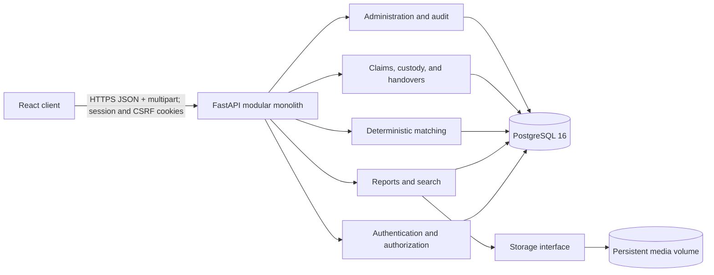

# Architecture

FindIt Next 2.0 is a modular monolith: one React application, one FastAPI application, one PostgreSQL database, and a storage adapter backed by a persistent local volume in development. The deployment boundary is intentionally simple while domain modules remain separated in code.



## Repository layout

```text
.
├── backend/                 FastAPI package, Alembic migrations, and pytest suite
├── frontend/                React/Vite application and Vitest/Playwright suites
├── docs/                    Architecture, security, and API conventions
├── scripts/dev.ps1          PowerShell-friendly development commands
├── docker-compose.yml       Local application topology
├── .env.example             Non-secret configuration template
└── README.md                Operator and contributor guide
```

## Module boundaries

- **Authentication:** password credentials, server-side session lifecycle, CSRF enforcement, profile access, role checks, and login throttling.
- **Reports:** lost/found reports, categories and locations, visibility-safe projections, image metadata, storage, search, and filters.
- **Matching:** deterministic candidate retrieval and ranking. It consumes public/normalized report data and exposes reasons with a heuristic score; it does not call an external model.
- **Claims:** private evidence, explicit state transitions, staff review, custody, approval, handover completion, and related notifications.
- **Administration:** staff permissions, controlled reference data, moderation, audit history, and aggregate operational metrics.
- **Notifications:** persisted user events exposed through polling-friendly endpoints.

HTTP route handlers should only validate transport concerns and call domain/application services. Services own authorization-sensitive workflows and transaction boundaries. Repositories or focused query functions contain non-trivial persistence logic; simple CRUD need not be hidden behind an abstract interface.

## Data and privacy boundaries

Public report responses are explicit projections and never serialize ORM models wholesale. Private ownership details, claim evidence, storage locations, session material, and internal audit context are excluded unless the authenticated role and operation require them. Image downloads resolve an opaque image identifier through the storage service rather than accepting a filesystem path.

The development storage adapter writes under `/app/storage/media`, which is a named Docker volume. Its interface is designed so an object-storage adapter can replace it without changing report workflows.

## Key invariants and transactions

- Roles are assigned only through an administrator-controlled path or the initial administrator CLI; public registration always creates a student.
- A report's owner and lost/found identity cannot be changed after creation.
- A claimant cannot claim their own found report, and cannot create a second active claim for the same report.
- Only valid claim transitions are accepted. Rejected and completed states cannot be reopened through student operations.
- Claim approval locks the relevant claim/report rows and rejects a competing approval if an approved active claim already exists.
- Handover completion and its custody/report/claim updates, notification, and audit event commit atomically.
- Audit records are append-only through normal application APIs.

## Matching design

Candidate retrieval considers every eligible complementary open report; pagination is applied only after scoring. The matcher combines category agreement, normalized token/attribute overlap, approximate location, and time proximity. Negative or absent signals are represented explicitly. Returned explanations identify which signals contributed, and the numeric value is always labeled a **heuristic score**, never a probability.

The optional image-similarity boundary accepts report image descriptors and returns scored evidence. The local MVP uses a no-op implementation, so no external service, network call, or paid API is required.

## Runtime topology

Docker Compose starts PostgreSQL first, waits for `pg_isready`, then starts the backend. The backend applies Alembic migrations before serving and exposes a health endpoint. The frontend starts after that endpoint becomes healthy. Source directories are bind-mounted for hot reload; database, uploaded media, and container-installed frontend dependencies use separate named volumes.

The separate production Compose topology terminates TLS with Caddy and keeps the frontend, API and database unpublished. Authentication admission limits are shared through PostgreSQL. A deployment must still manage secrets, use durable media storage, validate trusted proxy boundaries, back up PostgreSQL/media together, and control release migrations. See production-release.md and issue-fixes-verification.md for requirements and executed checks.

